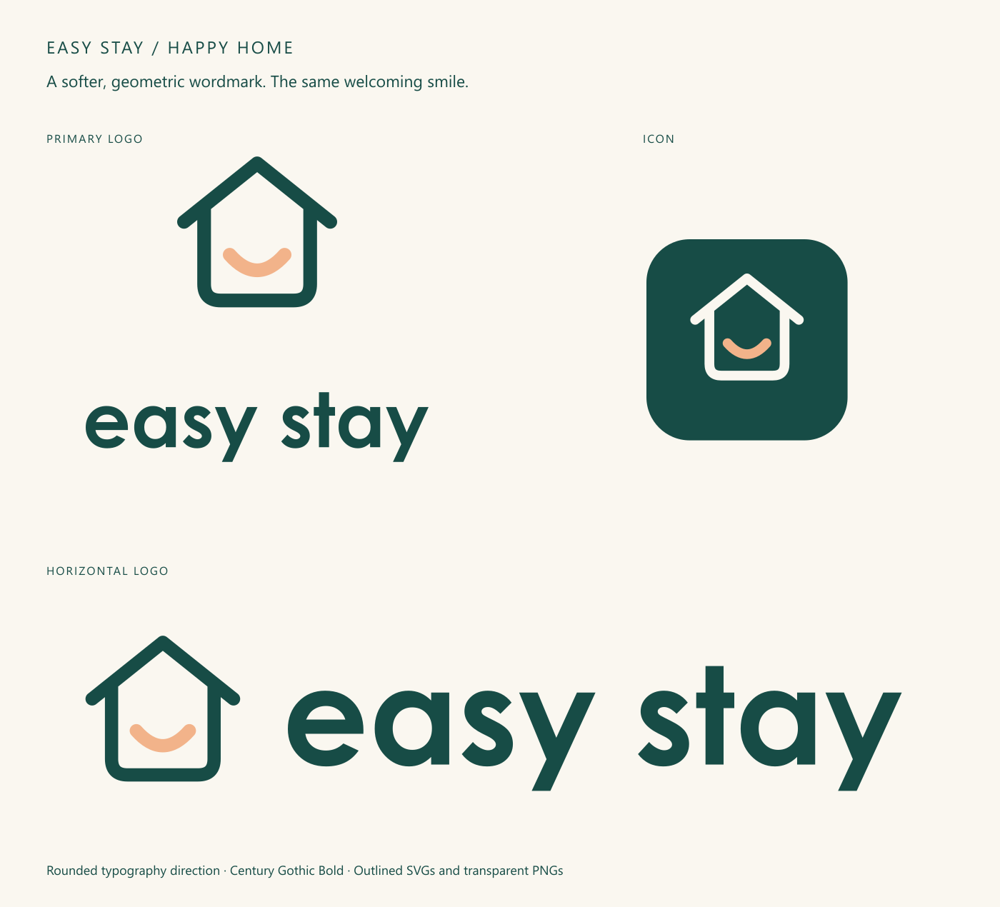

# Easy Stay branding

Brand strategy, selected Happy Home logos, and launch references for Easy Stay's group-stay homes in Petaling Jaya and Kuala Lumpur.

## Start here

- [Current identity and asset guide](brand/identity.md)
- [Brand profile and launch playbook on Google Docs](https://docs.google.com/document/d/1zHKxxO-JmqFb8pJlMffgC3OXxOs1HnsFZIz14unsdpg/edit)
- [Selected colour logos](logos/colour): primary, horizontal and icon in SVG and PNG.
- [Selected black-and-white logos](logos/monochrome): the same roof-and-smile design.
- [QC review](reference/qc-review.md) and [proposed platform addendum](reference/platform-brand-addendum.md): review material, not confirmation of operational claims.
- [Archived concepts](archive): earlier Open Door, initial variations and ES monogram; do not use for new materials.

The Google Doc is the working brand profile. The archived v1 profile predates the selected logo and is retained for context, not as current visual guidance. Editing the Google Doc does not automatically update this repository.

## Working rules

Use the existing selected SVG masters; preserve geometry and proportions. Keep proposals separate from confirmed business facts. Confirm inventory, pricing, capacity, policies and booking functionality before publishing claims. Never commit guest records, PMS exports, payment data, credentials or environment secrets.

These materials are supplied for Easy Stay's internal brand work. No open-source licence is granted by this repository. No font files are included.
